# model-routing

**Send every AI coding task to the cheapest model that can still be proven right, then have models from *other* companies check the work.**

A [Claude Code](https://claude.com/pricing) skill that routes work across Claude (Haiku, Sonnet, Opus), Codex (GPT-6.1 Sol / Terra, GPT-6 Astra), Antigravity (Gemini 4 Argon) and Grok. A typed classifier picks the lane in under a second, workers run headless in their own git worktree, a cross-vendor review panel checks every diff, and a ledger records what each run cost.

  


[In plain words](#in-plain-words) · [How it works](#how-it-works) · [Real numbers](#real-numbers) · [Stack](#stack) · [Quick start](#quick-start) · [Configure your accounts](#configure-your-accounts) · [Files](#files) · [Tests](#tests) · [Credits](#credits)

---

## In plain words

Think of a hospital.

A **triage nurse** looks at each patient for a few seconds and sends them to the right doctor. A sprained ankle does not need the head of surgery. A heart attack should not wait for the intern. Before anyone goes home, **doctors from other hospitals** give a second opinion. They had no part in the treatment, so they have no reason to go easy on it. And everything goes into the **patient's chart**.

This project does the same for coding tasks given to AI:

- The **nurse** is Jev, a small and very fast classifier. It reads the task description and says what kind of task it is and how risky it looks.
- The **doctors** are AI models. Cheap, fast ones take the simple jobs. Expensive, careful ones take the hard jobs.
- The **second opinion** is the review panel. Models from other companies read the change and point out mistakes.
- The **chart** is the ledger. Every run is written down with its model, cost and result.

Why bother? An expensive model on an easy task wastes money and usage limits. A cheap model on a hard task wastes your time. Routing picks the cheapest option that can still be checked.

**Words used below, one line each**

| Word | Meaning |
|---|---|
| **Model** | An AI that reads and writes code, such as Claude Opus 5.5 or GPT-6.1 Terra. Bigger models are smarter and cost more. |
| **Effort** | How long a model may think before it answers, from `low` to `xhigh`. |
| **Lane** | One concrete choice of model + effort + account, for example "Sonnet 5.5, high effort, on team seat B". |
| **Coordinator** | The main AI session you talk to. It writes the briefs, routes, checks and merges. It does not do the bulk typing. |
| **Worker** | An AI run with no chat window, started in the background to do one task. |
| **Worktree** | A separate copy of the project folder, so a worker cannot break your main copy. |
| **Review panel** | Three reviewers from other companies read the change in parallel. A judge merges their findings and keeps only what it can verify. |
| **Ledger** | A plain table file with one row per run: account, model, tokens, cost, result. |

---

## How it works

Every task follows the eight steps in the diagram above:

1. The coordinator writes a **brief**: goal, scope, constraints, non-goals, and the exact command that proves the work is done.
2. `route.ts` sends **only the brief** to [TypeSafe Jev](https://docs.typesafe.ai/concepts/system-one.md). Jev answers in 0.2–0.6 s with typed answers and probabilities: the task class, risk, context size, and whether secrets are involved. Each brief costs about $0.00005 (measured 2026-11-07, `jev-1.14.0`).
3. A deterministic function, `pickLane()`, turns that answer into a lane (rules below).
4. `dispatch.sh` runs the worker CLI **headless, in a linked git worktree**, and writes a `start` and a `done` row to the ledger.
5. `review-panel.sh` runs the **review panel**: three reviewers from vendors other than the builder, in parallel and read-only.
6. A **judge** debates and dedupes the findings, checks each one against the code, and labels it CONFIRMED, PLAUSIBLE or REJECTED.
7. The coordinator **verifies for real**: it reads the diff, runs the tests and opens the real app.
8. Only then does it **merge**. If a check fails, the task is retried on the same rung with a sharper brief, then one rung up, and the third time the coordinator takes over.

### The model ladder



The rule is simple: **each task runs on the cheapest rung whose verifier can still prove it correct.** The coordinator lives on the top rung (Opus xhigh on the main account, which has no 5-hour cap). Builds never go there. The dollar figures are [Artificial Analysis Intelligence Index v5](https://artificialanalysis.ai/models/claude-opus-5-5) cost per task. They show the order of magnitude; the ledger is the real source.

**How `pickLane()` decides**, in order:

| # | Rule | What it does |
|---|---|---|
| 1 | Secrets guard | If Jev thinks the brief touches secrets (p > 0.5), no worker gets it: the lane is `coordinator_only`. `route.ts` also refuses to send a brief that contains a secret-looking value. |
| 2 | Base lane | The task class picks the starting rung (table below). |
| 3 | Risk bump | Risky work (risk p > 0.6), or an unsure risk answer (\|2p − 1\| < 0.4), moves one rung up. |
| 4 | Ambiguity bump | If Jev is unsure of the class (confidence < 0.55), one rung up. |
| 5 | Context guard | Large context never goes to Haiku; extra-large goes to Opus high. |
| 6 | Pool capacity | The ledger picks the least-recently-used team seat that is not cooling down. If none fits, the task overflows to Codex, then Antigravity, then Grok. Planning and review are never silently downgraded. |
| 7 | Review panel | Feature, refactor, debug and planning work always get a panel. Other classes get one when Jev recommends cross-vendor review (p > 0.5). |

If Jev times out (> 2 s), errors, or is unsure of the class (confidence < 0.4), `route.ts` falls back to a keyword classifier (`scripts/router-fallback.ts`). That classifier always attaches a review panel. Every decision goes to `router-log.jsonl`.

| Task class | Default lane | One rung up | Review |
|---|---|---|---|
| `bulk_extraction` | Haiku max (team seat) | Terra xhigh (Codex) | script count |
| `mechanical_edit` | Haiku max | Sonnet high | coordinator reads the diff |
| `feature_frozen` | Sonnet high | Opus medium | review panel |
| `refactor_multifile` | Opus medium | Opus high | review panel |
| `debug_hard` | Opus high | Sonnet max | review panel |
| `planning_spec` | Opus xhigh (main account) | debate with Astra / Argon | Sol xhigh + Argon high, coordinator judges |
| `review_frozen` | review panel | Sol high escalation | is the review |
| `research_recent` | Astra xhigh (Codex) | Argon high | coordinator checks citations |
| `chat_qa` | Haiku medium | Haiku max | coordinator |

### The review panel


- **Reviewers run in parallel and read-only.** By default that means two GPT-6.1 Terra (Codex, high effort) and one Gemini 4 Argon (Antigravity, high). The third vendor adds diversity.
- **The judge** (GPT-6.1 Terra, high) receives every report. It merges duplicates, argues for and against each finding, checks it against the code, and labels it. It marks findings that need a test as `Escalate: dispute | needs-test`.
- **Escalation** (GPT-6.1 Sol, high) runs only with `--escalate` and only for those findings. It is the only member allowed to run tests. Its brief forbids source edits, it needs a linked worktree, and `review-panel.sh` compares `git status` before and after.
- **Never the builder's vendor.** The members change with whoever wrote the diff:

| Diff built by | Reviewers | Judge | Escalation |
|---|---|---|---|
| Claude or Grok | 2× GPT-6.1 Terra high + Gemini 4 Argon high | Terra high | Sol high |
| Codex | Opus 5.5 high + Gemini 4 Argon high | Opus high | Opus high (tests allowed, edits denied) |
| Antigravity | 2× GPT-6.1 Terra high + Opus 5.5 high | Terra high | Sol high |

The panel writes `final.md` (verdicts plus seconds, tokens and estimated USD for each call) and adds one `start` and one `done` row per call to the ledger. Act on CONFIRMED. PLAUSIBLE needs escalation or your own proof. REJECTED is dropped.

### Who works for whom



- **Main account** (for example a Claude Ultra plan): runs the coordinator, planning and judging at Opus xhigh. It has no 5-hour cap.
- **Team seats** (N seats on one Claude Team org): each seat is a separate `CLAUDE_CONFIG_DIR`. The ledger rotates builds across seats before any seat hits its 5-hour window.
- **Codex Pro**: review panel members and overflow builds. It has no 5-hour limit, only a weekly cap.
- **Google AI Pro**: Antigravity (`agy`), the third reviewer and second overflow. The quota is 1,500 requests per user per day.
- **X subscription**: Grok, the last overflow. Its weekly pool is shared with Cursor, and xAI publishes no fixed count.
- **Pool ledger**: `.coord/model-routing/pool-ledger.tsv`, one per project and git-ignored. When a run hits a usage limit, its account is marked `cooling` until the reset.

---

## Real numbers

Data from the pool ledger of one production project over 2026-11-06 and 2026-11-07. The ledger logged 75 runs. The six Claude lanes below cover 59 of them, and Claude reported **$211.65** in total.



| Lane | Runs | Average cost per run |
|---|---:|---:|
| Opus 5.5 · medium | 24 | $6.17 |
| Opus 5.5 · xhigh | 2 | $5.02 |
| Opus 5.5 · high | 5 | $3.69 |
| Sonnet 5.5 · high | 26 | $1.32 |
| Haiku 5.5 · max | 1 | $0.39 |
| Sonnet 5.5 · medium | 1 | $0.35 |

Sonnet high did the most runs at about a fifth of the Opus medium price per run. Opus medium took about 70% of the spend.



| Call | Model | Wall time | Cost |
|---|---|---:|---:|
| Reviewer 1 | GPT-6.1 Terra high | 64.8 s | $0.098 |
| Reviewer 2 | GPT-6.1 Terra high | 84.2 s | $0.104 |
| Reviewer 3 | Gemini 4 Argon high | 863.2 s | not reported by `agy` |
| Judge | GPT-6.1 Terra high | 97.9 s | $0.118 |
| Escalation | GPT-6.1 Sol high | 106.6 s | $0.227 |
| **Total** | | | **$0.55** |

Result: 15 findings → **12 confirmed, 1 plausible, 2 rejected**, and the escalation proved 1 with a test.

Earlier evidence for vendor diversity: in the same project, GPT-6.1 Sol high and Gemini 4 Argon high reviewed the same diff independently. They overlapped on 3 findings, and each caught bugs the other missed (Sol 4, Argon 6).

**Caveats, honestly**

- **This is one project over two days.** It shows what happened, not what will happen to you. The skill says to re-evaluate the panel after 10 panels, comparing confirmed findings per dollar and per minute against a single Sol review.
- **Claude costs** are the `total_cost_usd` that Claude Code itself reports, which is the price at API rates. On a subscription you pay the flat plan, not this number.
- **Codex costs** are estimates: `codex exec --json` prints tokens only, so `review-panel.sh` multiplies them by list prices (`LIST_PRICE` in `scripts/lanes.ts`). **Antigravity** reports no cost at all.
- **The idea of a two-Terra panel with a judge came from a tweet** (same PR, 2× Terra high caught 2 bugs that a single Sol high missed, for half the price). That is an anecdote from someone else's setup, not a benchmark.
- **The Sol vs Argon comparison is n = 1.**

---

## Stack

| Piece | Tested version | Headless call | Docs |
|---|---|---|---|
| Claude Code | 2.1.319 | `claude -p` | [Plans and limits](https://claude.com/pricing) |
| Codex CLI | codex-cli 0.167.0 | `codex exec` | [Codex pricing](https://developers.openai.com/codex/pricing) · [plan details](https://learn.chatgpt.com/docs/pricing) |
| Antigravity | agy 1.5.3 | `agy -p` | [Quota and pricing](https://geminicli.com/docs/resources/quota-and-pricing/) · [verified CLI notes](skills/model-routing/reference-agy-cli.md) (written for 1.5.2; the panel command was re-run on 1.5.3) |
| Grok Build | 1.0.78 | `grok` | xAI publishes no fixed quota; check `grok --help` |
| TypeSafe Jev | `jev-1.14.0` | `POST https://api.typesafe.ai/v1/systemone` | [System One API](https://docs.typesafe.ai/api/system-one.md) · [primitives](https://docs.typesafe.ai/primitives.md) · [confidence](https://docs.typesafe.ai/confidence.md) · [models and prices](https://docs.typesafe.ai/models.md) |
| Runtime | Node 26 (`--experimental-strip-types`, needs ≥ 22.6) or Bun 1.4 | | Zero npm dependencies |
| Shell tools | `bash`, `git`, `jq` | | `dispatch.sh` needs `jq` |

| Vendor | Model | Used for |
|---|---|---|
| Anthropic | Claude Haiku 5.5 | bulk work, extraction, mechanical edits, quick questions |
| Anthropic | Claude Sonnet 5.5 | features that touch one or two files |
| Anthropic | Claude Opus 5.5 | refactors, hard bugs, plans and specs, judging |
| OpenAI | GPT-6.1 Terra | review panel reviewers and judge, bulk overflow |
| OpenAI | GPT-6.1 Sol | escalation that proves findings with tests, spec attack, overflow builds |
| OpenAI | GPT-6 Astra | design debate, research on recent facts |
| Google | Gemini 4 Argon (low / medium / high) | third-vendor reviewer, overflow builds |
| Google | Gemini 3.8 Flash | bulk overflow |
| xAI | Grok 4.7 | last-line overflow builds |

CLI flags were re-checked against each `--help` on 2026-11-07. Re-check them when a CLI version changes; [`SKILL.md`](skills/model-routing/SKILL.md) lists the exact commands each lane runs and the known traps (`agy` has no `-f`, `grok` has no `-C`, `codex exec -p` means profile, not prompt).

---

## Quick start

**1. Install the skill**

```bash
git clone <this repo> model-routing && cd model-routing
ln -s "$PWD/skills/model-routing" ~/.claude/skills/model-routing
```

**2. Name your team seats** (see [Configure your accounts](#configure-your-accounts))

```bash
mkdir -p ~/.config/model-routing
cat > ~/.config/model-routing/config.json <<'EOF'
{ "seats": ["seat-a", "seat-b"], "mainAccount": "main", "seatConfigDirPattern": "~/.claude-{seat}" }
EOF
CLAUDE_CONFIG_DIR=~/.claude-seat-a claude      # log each seat in once
node --experimental-strip-types skills/model-routing/scripts/config.ts   # print the resolved config
```

**3. Add your TypeSafe key** (read at runtime, never stored in the repo)

```bash
mkdir -p ~/.config/typesafe
$EDITOR ~/.config/typesafe/key        # the bare key, or TYPESAFE_API_KEY=...
chmod 600 ~/.config/typesafe/key      # $TYPESAFE_KEY_FILE overrides the path
```

**4. Route → dispatch → review**

```bash
S=~/.claude/skills/model-routing
git worktree add ../wt-T51 -b T51 && WT=$(cd ../wt-T51 && pwd)   # builds run only in a linked worktree

node --experimental-strip-types $S/route.ts brief.md --repo "$WT" > lane.json   # or: bun $S/route.ts ...
jq '{lane, model, effort, account, reasons}' lane.json                           # read it before launching

$S/dispatch.sh lane.json --run-id T51 --dry-run   # then without --dry-run
$S/review-panel.sh review-brief.md "$WT" T51-review --builder claude --dry-run   # add --escalate to run Sol
cat "$WT/.coord/model-routing/runs/T51-review/final.md"

node --experimental-strip-types $S/scripts/pool-ledger.ts report --days 7       # cost by account, vendor, model
```

`route.ts` options: `--repo DIR`, `--ledger PATH`, `--no-jev`, `--touches-secrets` (returns `coordinator_only` without calling Jev), `--timeout-ms N`, `--builder claude|codex|agy|grok`. `dispatch.sh` refuses `coordinator_only` lanes, cooling accounts, unknown accounts, and build lanes outside a linked worktree (`--allow-main-checkout` overrides).

---

## Configure your accounts

The router assumes one **main** Claude account (default config dir, used for planning and judging), N Claude **team seats** (one `CLAUDE_CONFIG_DIR` each, rotated for builds), plus Codex (`~/.codex`), Antigravity (`agy`) and Grok CLIs. Seat names are not hard-coded; they are resolved by `skills/model-routing/scripts/config.ts`, highest precedence first:

1. `MODEL_ROUTING_SEATS` — comma list, e.g. `MODEL_ROUTING_SEATS=seat-a,seat-b`. Overrides `seats` from the file.
2. `~/.config/model-routing/config.json` (or the path in `MODEL_ROUTING_CONFIG`):

   ```json
   {
     "seats": ["seat-a", "seat-b", "seat-c", "seat-d"],
     "mainAccount": "main",
     "seatConfigDirPattern": "~/.claude-{seat}"
   }
   ```

3. Defaults: seats `seat-a`, `seat-b`, `seat-c`, `seat-d`; main account `main`; seat dir `~/.claude-{seat}`.

- `seats`: ledger names of your team seats. Letters, digits, `.`, `_`, `-` only; `codex`, `google`, `grok`, `coordinator` and `panel` are reserved.
- `mainAccount`: ledger name of the main account. Its runs unset `CLAUDE_CONFIG_DIR`.
- `seatConfigDirPattern`: where each seat's Claude config lives; `{seat}` is replaced by the seat name. Log each seat in once with `CLAUDE_CONFIG_DIR=~/.claude-seat-a claude`.

Check the result with `node --experimental-strip-types skills/model-routing/scripts/config.ts`. `dispatch.sh` refuses an account that is not configured or whose config dir is missing. Keep the config file outside the repo: seat names are often personal.

---

## Files

```
skills/model-routing/
├── SKILL.md                         # the full rules, lane catalogue, evidence and sources
├── package.json                     # {"type": "module"}, no dependencies
├── route.ts                         # <brief> → Jev → pickLane() → lane JSON on stdout
├── dispatch.sh                      # lane JSON → background headless run + ledger start/done rows
├── review-panel.sh                  # <brief> <repo> <run-id> → reviewers ∥ → judge → final.md
├── reference-agy-cli.md             # verified agy reference (flags, permissions, JSON, exit codes)
├── reference-third-party-skills.md  # survey of routing ideas in pstack, tstack and mattpocock/skills
├── scripts/
│   ├── config.ts                    # team seats, main account, seat config dir
│   ├── lanes.ts                     # lane catalogue, rung-up / overflow / reviewer rules, command builders
│   ├── router-fallback.ts           # keyword classifier (Jev timeout, error or unsure class), secret guard
│   ├── panel.ts                     # review-panel helpers: pick members, summarize a call, count verdicts
│   ├── pool-ledger.ts               # ledger append/read, next-seat, cooling, status, report
│   └── watchdog-integration.sh      # runs <repo>/.coord/watchdog.sh if present, else lists run states
└── tests/                           # offline tests (no network, no API keys)
docs/diagrams/
├── *.svg                            # the figures in this README
└── src/*.html                       # their editable sources
```

## Tests

```bash
cd skills/model-routing && node --experimental-strip-types --test tests/*.test.ts   # or: bun test tests/
```

The tests run offline. They cover seat config, the unsure-risk regression, panel shapes, cross-vendor and cold-pool cases, verdict counting and Codex / agy output parsing.

---

## Credits

- **[pstack](https://github.com/cursor/plugins/tree/main/pstack)** (cursor/plugins): the role → model / effort matrix, and judges from a different model family (`arena`, `interrogate`).
- **[tstack](https://github.com/t3dotgg/tstack)** (t3dotgg): `council` and `sol-loop`, review rounds across providers and a findings ledger.
- **[mattpocock/skills](https://github.com/mattpocock/skills)**: two reviewers on independent axes (`code-review`), frontier scheduling across worktrees (`implement-spec`), the software-factory vocabulary, and a fresh context for every subagent.
- **Jinjing Liang** (post on X, 2026-11-06): the two-Terra-reviewers-plus-judge setup that the default panel is based on.
- **[TypeSafe](https://docs.typesafe.ai/concepts/system-one.md)**: Jev and the System One primitives that make routing a typed decision instead of a prompt.
- Diagrams drawn with the [diagram-design](https://github.com/cathrynlavery/diagram-design) skill.

## License

MIT, see [LICENSE](LICENSE). Author: Carlos Ziegler.
